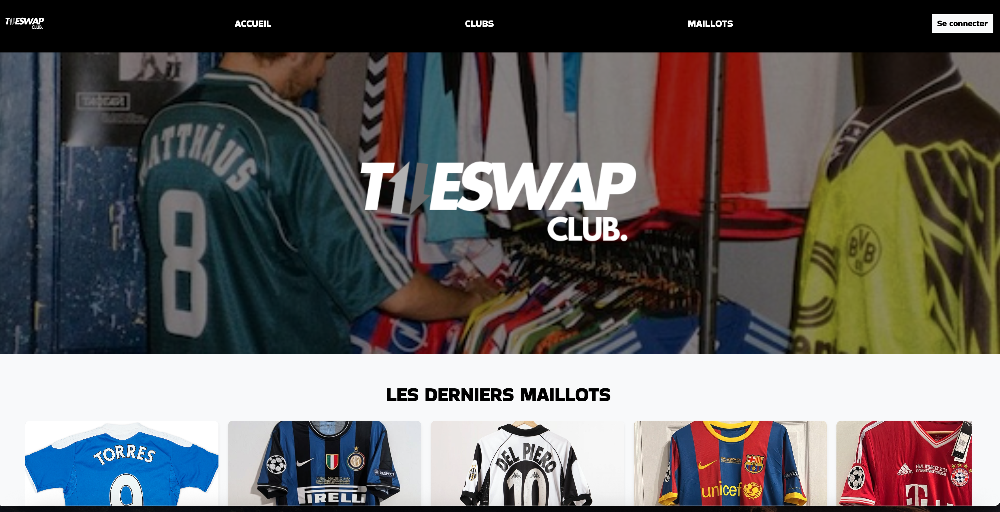
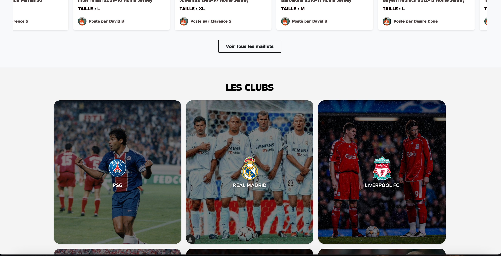
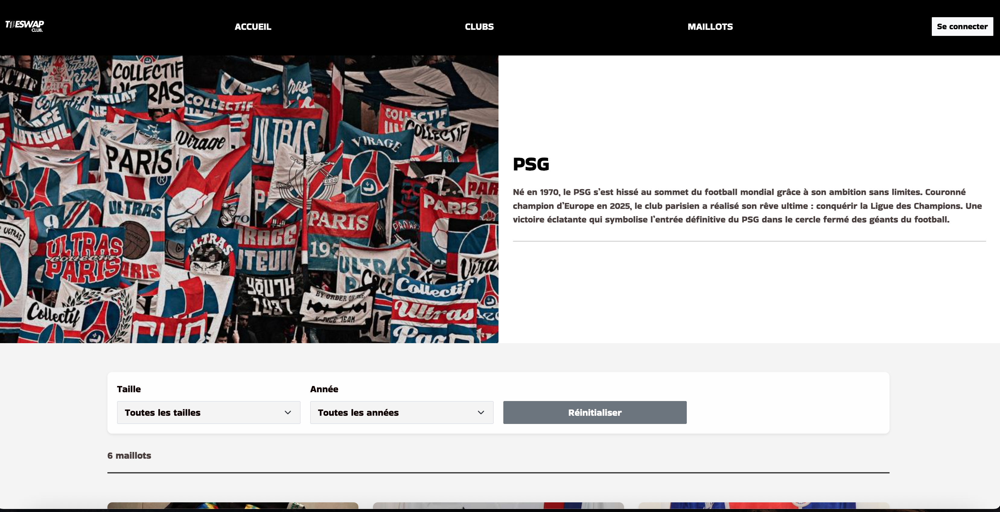
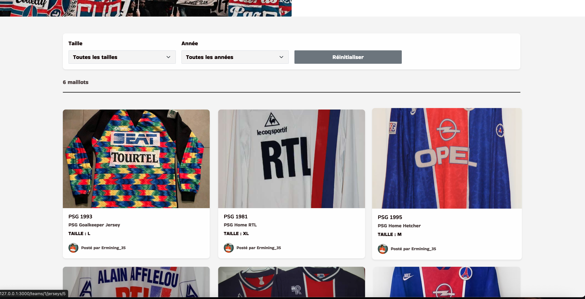
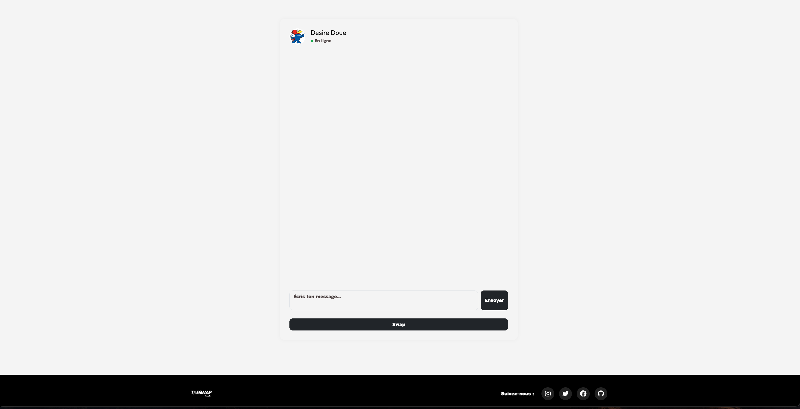
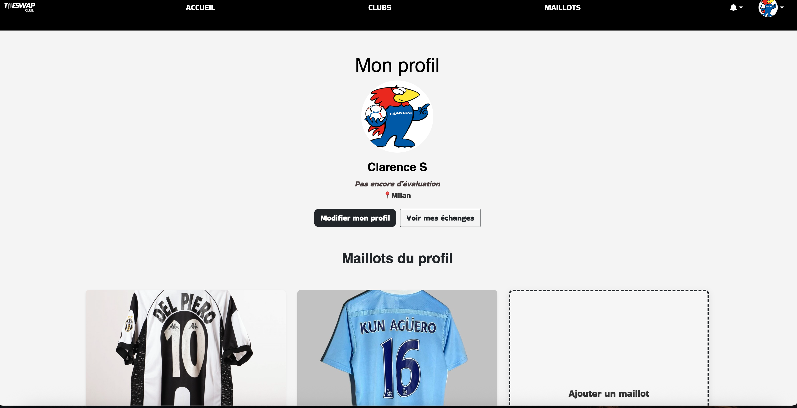

# THE_SWAP_CLUB ⚽👕

Plateforme web permettant aux passionnés de sport d’échanger des maillots entre particuliers.
Les utilisateurs peuvent proposer leurs maillots, rechercher ceux des autres, organiser un échange, discuter via un chat et laisser des avis après la transaction.

---

## ✨ Fonctionnalités principales
- Authentification des utilisateurs (Devise : inscription, connexion, profil)
- Gestion des maillots : création, édition, affichage
- Création et suivi des échanges (*exchanges / trades*)
- Messagerie instantanée entre membres (chat & messages)
- Reviews : laisser une évaluation après un échange
- Notifications (alertes sur nouveaux messages, échanges, etc)
- Gestion des équipes (*teams*) pour regrouper les membres
- Recherche avancée (filtre par équipe, taille, état du maillot)

---

## 🧱 Stack & Outils
- **Back-end** : Ruby on Rails
- **Front** : ERB / SCSS
- **Authentification** : Devise
- **Base de données** : PostgreSQL
- **Autres gems** : gem "bootsnap",
                    gem "bootstrap", "~> 5.3"
                    gem "autoprefixer-rails"
                    gem "font-awesome-sass", "~> 6.1"
                    gem "simple_form",
                    gem "sassc-rails"
                    gem "dotenv-rails"
                    gem "debug"
                    gem "web-console"
                    gem "capybara"
                    gem "selenium-webdriver"
                    gem devise
                    gem "devise"
                    gem "cloudinary"
                    gem "activestorage-cloudinary-service"

## 📸 Captures d’écran

### Page d’accueil

### Page d’un maillot

### Chat

### Profil

